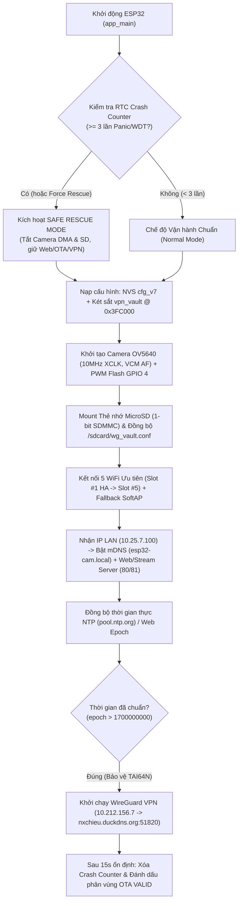

# ESP32-CAM Industrial Smart Meter & Edge-to-Server AI Vision System
> **Tài liệu Kỹ thuật Toàn diện (AI-Optimized Specification & Architecture Reference)**  
> **Cập nhật lần cuối**: 2026-10-22  
> **Dự án**: `e:\00_Code\esp32-cam`

---

## 1. Tổng quan Hệ thống & Sơ đồ Hạ tầng (System Topology)

Dự án xây dựng một hệ thống **Camera Công nghiệp Đọc Chỉ số Đồng hồ Tự động (AMR - Automatic Meter Reading) & Giám sát Trạng thái Thiết bị** kết hợp xử lý biên (**Edge AI trên ESP32-CAM**) và xử lý chuyên sâu (**Deep AI Vision + Historical State-Space Filter trên Server RK3576 NPU**).

### 1.1. Danh mục Thiết bị & Máy chủ trong Hệ sinh thái

| Thực thể | Địa chỉ IP / Định danh | Thông tin Phần cứng & Dịch vụ | Vai trò trong Hệ thống |
|---|---|---|---|
| **ESP32-CAM Node** | LAN: `10.25.7.100`<br>mDNS: `esp32-cam.local`<br>VPN: `10.212.156.7` | - SoC: `ESP32-D0WD-V3` (Dual-Core Xtensa LX6 @ 160MHz Eco)<br>- Flash: `4MB SPI Flash` (`DIO`, `40MHz`)<br>- PSRAM: `8MB External SPI RAM` (`4MB` mapped)<br>- Camera: **OV5640 5MP (`PID=0x5640`, SCCB `0x3C`)** có **VCM Autofocus**<br>- Đèn phụ: **High-Power White LED tại `GPIO 4` (LEDC PWM 5kHz 8-bit)**<br>- Ngoại vi mở rộng: **`GPIO 33` (Rear Red Heartbeat LED)**, **`GPIO 12` (Relay Output)**, **`GPIO 13` (Pulse/Tamper Input)**<br>- Lưu trữ: **MicroSD SU16G (`15,193 MB`)** giao tiếp **1-bit SDMMC** (`GPIO 14, 15, 2`) | Chụp ảnh định kỳ/thích ứng, nháy đèn phụ chống lóa, chạy Edge AI (Motion, Luma, Đèn báo, 7-Seg, Góc kim đỏ), đóng dấu OSD, lưu SD Ring-Buffer, đẩy FTP/HTTP/MQTT, duy trì hầm VPN WireGuard & OTA kép. |
| **Windows Build & Direct OTA Host** | Máy chính Windows<br>(`e:\00_Code\esp32-cam`) | - Môi trường: **`ESP-IDF v5.5.1`** (`C:\Users\nguye\esp\v5.5.1\esp-idf`)<br>- Công cụ triển khai 1 lệnh: `python tools/deploy.py` (tự động dò IP mạch qua MQTT `10.25.7.171:1883` và đẩy OTA trực tiếp)<br>- *(Dự phòng)* Máy Linux `100.126.145.106` (`/dev/ttyUSB0`) chỉ dùng khi cần nạp cứu hộ qua cáp UART cứng. | Đóng gói Web UI (`pack_ui.py`), biên dịch `cam_streamer.bin` cục bộ, đồng bộ AI Server `.171` và đẩy Firmware OTA không dây sang ESP32-CAM. |
| **Deep AI & FTP/MQTT Server** | `10.25.7.171`<br>User: `root` | - SoC: Rockchip **RK3576 NPU** (tăng tốc phần cứng `rknn-toolkit-lite2`)<br>- AI Hub HTTP: `http://10.25.7.171:8095` (`esp32cam-ai.service`)<br>- FTP Server: `10.25.7.171:21` (User `nxchieu`, thư mục `/var/ftp/esp32cam`)<br>- MQTT Broker: `mqtt://10.25.7.171:1883` (`esp32cam/#`) | Nhận ảnh từ ESP32-CAM, chạy YOLOv8n NPU + 5 pipeline đọc đồng hồ (LED, 7-Seg, LCD, Kim quay, Đa màn hình xoay vòng), lọc sai số lịch sử `V(t-1)` & `MultiScreenCycleTracker`, lưu kho ảnh `/annotated` và cấp phát file `.bin` cho OTA Pull. |
| **Notification & Memory Hub** | `10.25.7.116` | - Ntfy Push Server: `http://10.25.7.116:8092/esp32cam`<br>- Memos Server: `http://10.25.7.116:5230` | Gửi thông báo đẩy thời gian thực về điện thoại và lưu nhật ký vận hành. |
| **WireGuard VPN Gateway** | `nxchieu.duckdns.org:51820`<br>Subnet: `10.212.156.0/24` | - Giao thức: WireGuard (`ChaCha20-Poly1305` / `Curve25519` / `BLAKE2s`)<br>- IP tĩnh của mạch: `10.212.156.7/24` (`MTU 1360`) | Cho phép truy cập Web UI, xem luồng ảnh và nạp OTA xuyên NAT / 4G LTE mà không cần mở port router. |

---

## 2. Cấu trúc Thư mục & Mã nguồn Dự án

```text
e:\00_Code\esp32-cam\
├── AGENTS.md                        # Chỉ dẫn bối cảnh nhanh cho AI Agent
├── README.md                        # Tổng quan dự án
├── tools\
│   └── deploy.py                    # Công cụ 1 lệnh: Pack UI + Build ESP-IDF v5.5.1 + Đồng bộ AI .171 + Đẩy OTA
├── docs\                            # Tài liệu kỹ thuật đầy đủ
│   ├── PROJECT_DOCS_AI.md           # Tài liệu kiến trúc & nghiệp vụ chi tiết (cho AI & Dev)
│   └── index.html                   # Cổng tài liệu trực quan Tiếng Việt (cho Người đọc)
├── cam_streamer\                    # FIRMWARE CHÍNH CỦA MẠCH ESP32-CAM (ESP-IDF v5.5.1)
│   ├── CMakeLists.txt
│   ├── partitions.csv               # Bảng phân vùng 4MB Flash (Dual-OTA + CoreDump + vpn_vault)
│   ├── sdkconfig.defaults           # Cấu hình PSRAM, Camera AF, WireGuard PPP, CoreDump, TWDT
│   └── main\
│       ├── idf_component.yml        # Phụ thuộc: esp32-camera, esp_jpeg, mdns, trombik__esp_wireguard
│       ├── app_config.h / .c        # Quản lý cấu hình & Két sắt 4 tầng (vpn_vault @ 0x3FC000)
│       ├── app_wireguard.h / .c     # Quản lý hầm VPN WireGuard, TAI64N guard, DDNS 60s, Split-Tunnel
│       ├── hw_peripherals.h / .c    # Đèn phụ PWM GPIO 4, Ngoại vi mở rộng (GPIO 33, 12, 13), Điện áp & Nhiệt độ
│       ├── cam_streamer.c           # Khởi tạo phần cứng, Eco Mode, VCM AF ROI Sweep, Adaptive Scheduler, WDT
│       ├── osd_stamp.h / .c         # Giải mã RGB565 trên PSRAM, Edge AI (Motion/LED/7Seg/Dial), vẽ OSD
│       ├── net_services.h / .c      # NTP/Epoch Time, Passive FTP Client, MQTT Client (kèm LWT & IP), Ntfy, AI Push
│       ├── app_httpd.h / .c         # Web Server cổng 80, Stream Server cổng 81, /status, /control, /api/config
│       ├── httpd_ota_sys.h / .c     # Dual-OTA Upload/Pull/Rollback, FreeRTOS Task Profiler (/api/tasks), WireGuard API
│       ├── httpd_ai_mcp.h / .c      # Zero-Prompt Manifest (/api/ai/manifest), 1-Call Observe (/api/ai/observe), MCP (/mcp)
│       ├── web_ui.h                 # Mảng byte C chứa giao diện Web đã nén Gzip (~38.4 KB)
│       └── ui_src\
│           ├── style.css            # CSS chuẩn Responsive (hỗ trợ iPhone 12 390px & Desktop)
│           ├── body.html            # Cấu trúc DOM HTML 7 Tab chuyên biệt
│           ├── app.js               # Logic điều khiển SPA, ROI Touch Drag, Multi-Screen Tracker & Telemetry
│           ├── index.html           # File tổng hợp tự động sinh từ style.css + body.html + app.js
│           └── pack_ui.py           # Công cụ đồng bộ 2 chiều + minify + nén Gzip -> web_ui.h (-76.9%)
└── server_ai_171\
    └── esp32cam_ai_server.py        # FastAPI + RK3576 NPU + SmartMeterVisionEngine + MeterStateTracker + MultiScreenCycleTracker
```

---

## 3. Quy hoạch Bộ nhớ Flash 4MB, RAM/PSRAM & Phân vùng Bền vững `vpn_vault`

### 3.1. Bảng Phân vùng Flash 4MB (`cam_streamer/partitions.csv`)

```csv
# Name,     Type, SubType,  Offset,   Size,     Flags
nvs,        data, nvs,      0x9000,   0x5000,
otadata,    data, ota,      0xe000,   0x2000,
ota_0,      app,  ota_0,    0x10000,  0x1F0000,
ota_1,      app,  ota_1,    0x200000, 0x1F0000,
coredump,   data, coredump, 0x3F0000, 0xC000,
vpn_vault,  data, 0x99,     0x3FC000, 0x4000,
```

- **Giữ nguyên tuyệt đối địa chỉ `ota_0` (`0x10000`, `1,984 KB`) và `ota_1` (`0x200000`, `1,984 KB`)**: Đảm bảo mọi bản cập nhật OTA (qua Web Upload hoặc Pull từ `.171`) không bao giờ gặp xung đột offset. Dung lượng mỗi phân vùng đạt `1.98 MB` (hiện firmware chiếm `~1.23 MB`, còn trống `36%`).
- **Phân vùng `coredump` (`0x3F0000`, `48 KB`)**: Lưu trữ toàn bộ thanh ghi CPU và Call Stack khi xảy ra ngoại lệ `Panic / Guru Meditation`. Trạng thái `coredump_present` được đọc trực tiếp và cảnh báo trên giao diện Sức khỏe Hệ thống.
- **Phân vùng Bất tử `vpn_vault` (`0x3FC000`, `16 KB`, SubType `0x99`)**:
  - Đặt ở `16 KB` cuối cùng của chip Flash 4MB.
  - Không bị chạm tới bởi `idf.py flash`, cập nhật OTA, `nvs_flash_erase()`, thay đổi kích thước `sizeof(app_config_t)`, hay lệnh **Factory Reset**.

### 3.2. Cơ chế Bảo vệ Két sắt 4 Tầng (4-Tier Self-Healing VPN & WiFi Persistence)

Triển khai tại `main/app_config.c`:
1. **Tầng 1 — Raw Flash `vpn_vault` @ `0x3FC000` (Dual-Sector A/B)**:
   - Lưu cấu trúc `vpn_vault_flash_t` gồm: `magic = 0x57475632` (`"WGV2"`), `version`, cấu hình `app_wg_config_t wg`, 5 cấu hình `wifi_list[5]`, `mdns_host`, `device_name`, và mã kiểm tra **FNV-1a 32-bit checksum**.
   - **Ghi nguyên tử 2 Sector (Atomic Mirror-First Write)**: Khi lưu cấu hình, hệ thống xóa và ghi vào **Sector 1 (`0x1000` - Mirror)** trước, sau đó mới xóa và ghi vào **Sector 0 (`0x0000` - Primary)**. Nếu mất nguồn đột ngột đúng lúc đang xóa Sector 0, lần khởi động sau hàm `load_flash_vpn_vault()` phát hiện sai checksum ở Sector 0, tự động khôi phục từ Sector 1 và vá lại Sector 0 (`"vpn_vault @ 0x3FC000 (Mirror Healed)"`).
2. **Tầng 2 — NVS Namespace độc lập (`"wg_vault"` tại `0x9000`)**:
   - Lưu từng khóa lẻ (`en`, `priv`, `pub`, `psk`, `addr`, `mask`, `host`, `port`, `ka`), tách biệt hoàn toàn với blob `cfg_v7` của ứng dụng.
3. **Tầng 3 — Sao lưu dự phòng trên Thẻ nhớ (`/sdcard/wg_vault.conf`)**:
   - Tự động đồng bộ 2 chiều ngay khi mount thẻ nhớ (`app_vault_sync_sdcard()`).
   - Ngay cả khi chạy lệnh xóa trắng toàn bộ chip Flash (`esptool.py erase_flash`), ngay khi cắm thẻ nhớ, mạch sẽ đọc `/sdcard/wg_vault.conf`, khôi phục khóa WireGuard vào `0x3FC000` và kết nối lại VPN.
   - Sau khi Format FAT32 thẻ nhớ qua Web UI (`app_format_sd_card()`), file `/sdcard/wg_vault.conf` được tự động tái tạo ngay lập tức.
   - File `wg_vault.conf` bị ẩn khỏi API `/list` (`app_httpd.c`) để bảo vệ khóa riêng tư `PrivateKey`.
4. **Tầng 4 — Cấu hình Mặc định Cứng trong Firmware**:
   - Lưu sẵn cấu hình dự phòng `10.212.156.7` $\to$ `nxchieu.duckdns.org:51820` và WiFi Slot #1 `HA / 123123123`.

### 3.3. Quy hoạch Bộ nhớ RAM Nội (Internal SRAM) & PSRAM (`8MB`)

- **Internal SRAM (`~303 KB` khả dụng cho Heap, duy trì `~115 KB` trống khi chạy tải đầy đủ)**:
  - Chỉ dùng cho DMA Descriptor của WiFi/SDMMC, ngăn xếp tiến trình FreeRTOS (Task Stacks), và mã hóa bất đối xứng X25519 của WireGuard.
  - **Quy tắc bắt buộc trong code**: Không bao giờ cấp phát biến cục bộ lớn (`> 512 bytes`) trên Stack của `main` task hoặc `httpd` task. Các cấu trúc tạm như `vpn_vault_flash_t` (`~1.2 KB`) hoặc bộ đệm đọc file phải cấp phát động qua `calloc()`/`malloc()` và `free()` ngay sau khi dùng.
  - **Industrial Heap Guard**: Trong `background_worker_task`, nếu `heap_caps_get_free_size(MALLOC_CAP_INTERNAL) < 10240` (dưới 10 KB) liên tiếp 5 giây, mạch chủ động khởi động lại sạch trước khi xảy ra crash.
- **External PSRAM (`8MB` phần cứng, `4MB` mapped vào vùng địa chỉ CPU, duy trì `~3.94 MB` trống)**:
  - Chứa 2 bộ đệm khung hình JPEG của Camera (`fb_count = 2`, `CAMERA_GRAB_WHEN_EMPTY`).
  - Chứa bộ đệm giải mã ảnh `RGB565` (`640 x 480 x 2 = 614.4 KB`) phục vụ Edge AI và đóng dấu OSD (`heap_caps_malloc(..., MALLOC_CAP_SPIRAM | MALLOC_CAP_8BIT)`).

---

## 4. Nghiệp vụ Đọc Chỉ số Công nghiệp & Thuật toán AI (Business Logic)

Hệ thống hỗ trợ **5 chế độ đọc mục tiêu (`meter_mode = 0..4`)** bên trong vùng quan tâm **ROI (`roi_x_pct, roi_y_pct, roi_w_pct, roi_h_pct`)** có thể kéo vẽ trực tiếp bằng ngón tay hoặc chuột trên giao diện Web:

### 4.1. Bảng Chế độ Đọc (`meter_mode`) & Cấu hình Quang học ISP (`cam_isp_profile`)

| `meter_mode` | Tên chế độ nghiệp vụ | `cam_isp_profile` tương ứng | Thuật toán tại Biên (ESP32 Edge AI) | Thuật toán tại Server AI (`10.25.7.171:8095`) |
|---|---|---|---|---|
| **`0`** | **Tổng hợp Tự động (All/Auto)** | `0` - Balanced Auto | Chạy đồng thời đo chuyển động `32x24`, trạng thái đèn LED, phân đoạn 7-Seg và dò kim đỏ. | Chạy đồng thời YOLOv8n NPU + cả 4 bộ đọc (LED, 7-Seg, LCD, Kim quay). |
| **`1`** | **Đèn báo Trạng thái (Status Indicator LED)** | `1` - Anti-Blooming (`Bright=-2, Contrast=+2, Gain=2x`) | Tính `roi_luma`, `roi_max_luma` và tỷ lệ kênh màu `(R, G, B)` của điểm chói để phân loại `OFF`, `ON (DO)`, `ON (XANH LA)`, `ON (VANG)`, `ON (XANH DUONG)`. | Chuyển sang không gian màu `HSV`, lọc mặt nạ phát sáng (`V>=165, S>=55` hoặc `V>=220`), đóng khung từng bóng đèn sáng và phân loại màu chính xác. |
| **`2`** | **Đồng hồ Số LED 7 Thanh (7-Segment)** | `1` - Anti-Blooming | Cắt từng chữ số theo hình chiếu dọc, lấy mẫu 7 vùng thanh `(a,b,c,d,e,f,g)` và tra bảng bitmask `s_seg7_table`. | Cân bằng sáng cục bộ `CLAHE`, nhị phân hóa `Otsu`, chuẩn hóa kích thước `28x48`, giải mã bitmask 7 thanh kết hợp **Khoảng cách Hamming (`Hamming Distance = 1`)** để tự sửa lỗi khi 1 thanh LED bị mờ. |
| **`3`** | **Màn hình LCD / Số cơ (Điện, Nước, Khí)** | `2` - High-Contrast Anti-Glare (`Office WB, Contrast=+2, Sat=-1`) | Đảo ngược ngưỡng sáng (`invert_lcd = true`, chữ tối trên nền sáng) và giải mã dãy số. | Áp dụng `CLAHE (clipLimit=3.2)` + song song 2 nhánh nhị phân hóa (`Adaptive Gaussian Threshold` và `Otsu Inverted`), chọn nhánh có độ tin cậy cao nhất. |
| **`4`** | **Đồng hồ Nước Kim quay (Multi-Dial Rotary Water Meter)** | `4` - Red Pointer Boost & Anti-Glare (`Sunny WB, Bright=-1, Contrast=+2, Sat=+2`) | Chia ROI thành 4 vùng kim quay ($\times 0.1 \dots \times 0.0001$), lọc pixel kim đỏ, tìm mũi kim và tính góc quay $\theta = \operatorname{atan2}(dx, -dy) \pmod{360^\circ}$, ghép với phần nguyên `meter_baseline`. | Phát hiện vòng tròn bằng `HoughCircles`, trích xuất vector mũi kim đỏ/đen, giải mã **Khớp nối Bánh răng Liên cấp (Inter-Dial Gear Carry Coupling)** và lọc qua **Bộ lọc Trạng thái Lịch sử `MeterStateTracker` ($V_{t-1}$)**. |
| **`5`** | **Đồng hồ Đa Màn Hình Chuyển Vòng (Auto-Cycling Multi-Screen Meter)** | `2` - High-Contrast Anti-Glare (`Office WB, Contrast=+2, Sat=-1`) | Đọc dãy số hiện tại trên màn hình theo chu kỳ nhanh (`60s / 15s`). | Chạy **Dual-Zone OCR (`analyze_multi_screen`)** tách riêng **Mã trang / OBIS (`page_code`)** và **Chỉ số chính (`main_value`)**, lọc bỏ khung hình nhòe giao thời (`is_transition`) khi LCD đang lật trang, và phân bổ vào tối đa **12 khe độc lập (`MultiScreenCycleTracker`)** với khóa đơn điệu chọn lọc cho các khe lũy kế. |

### 4.2. Chi tiết Mô hình Đọc Đồng hồ Nước Kim quay & Lọc Sai số Lịch sử $V(t-1)$

Để giải quyết triệt để hiện tượng **đọc nhầm khi kim chỉ lửng giữa 2 vạch** hoặc **chữ số bánh răng cơ đang cuộn dở nửa chừng (half-rolling digit)**, hệ thống áp dụng chuỗi 3 tầng toán học:

1. **Tầng 1 — Trích xuất Vector Góc Kim Quay ($\theta_k \in [0^\circ, 360^\circ)$)**:
   - Với mỗi vòng tròn con thứ $k \in \{0, 1, 2, 3\}$ (tương ứng $\times 0.1, \times 0.01, \times 0.001, \times 0.0001\text{ m}^3$), hệ thống lọc mặt nạ màu đỏ trong không gian HSV (`H in [0..15] U [160..180], S >= 45, V >= 40`) bên trong hình tròn bán kính $R$.
   - Tính trọng tâm có trọng số theo khoảng cách từ tâm $(c_x, c_y)$ để xác định vector hướng mũi kim $(v_x, v_y)$ và góc quay theo chiều kim đồng hồ tính từ mốc 12 giờ:
     $$\theta_k = \left(\operatorname{atan2}(v_x, -v_y) \times \frac{180}{\pi} + 360^\circ\right) \pmod{360^\circ}, \quad f_k = \frac{\theta_k}{36.0} \in [0, 10)$$

2. **Tầng 2 — Khớp nối Bánh răng Liên cấp (Right-to-Left Gear Carry Coupling)**:
   - Giải mã từ đồng hồ con nhỏ nhất ($k = N-1$, bên phải) ngược lên đồng hồ con lớn nhất ($k = 0$, bên trái):
     $$d_k = \left\lfloor f_k - \frac{v_{k+1}}{10} + 0.5 \right\rfloor \pmod{10}$$
   - Ví dụ: Nếu kim $\times 0.1$ đang nằm gần vạch số `5` ($f_0 = 4.92$), nhưng kim $\times 0.01$ bên cạnh đang chỉ ở số `9` ($v_1 = 9.1 \implies \text{expected\_frac} = 0.91$), công thức cho ra $\lfloor 4.92 - 0.91 + 0.5 \rfloor = \lfloor 4.51 \rfloor = 4$ (chưa nhảy sang 5). Ngược lại nếu kim $\times 0.01$ đã qua số `0` ($v_1 = 0.8 \implies \text{expected\_frac} = 0.08$), công thức cho ra $\lfloor 4.92 - 0.08 + 0.5 \rfloor = \lfloor 5.34 \rfloor = 5$ (đã nhảy sang 5).

3. **Tầng 3 — Bộ lọc Trạng thái Lịch sử & Ràng buộc Đơn điệu (`MeterStateTracker`)**:
   - Dựa trên chỉ số hợp lệ liền trước $V_{t-1}$ tại thời điểm $t_{t-1}$ ($\Delta t = t - t_{t-1}$ giây) và lưu lượng vật lý tối đa $Q_{\max}$ (`meter_max_flow_lpm`, mặc định `50 L/phút` = `3.0 m³/h`):
     $$\Delta V_{\max} = \max\left(0.005,\; \frac{Q_{\max}}{60000} \times \Delta t\right) \quad (\text{m}^3)$$
   - **Các trạng thái quyết định của bộ lọc (`filter_state`)**:
     - `VALID_MONOTONIC`: Nếu $0 \le V_{\text{cand}} - V_{t-1} \le \Delta V_{\max}$ $\implies$ Chấp nhận $V_t = V_{\text{cand}}$ và cập nhật lưu lượng tức thời $Q_t = \frac{(V_t - V_{t-1}) \times 1000}{\Delta t / 60}$ ($\text{L/phút}$).
     - `CLAMPED_JITTER`: Nếu $-0.008 \le V_{\text{cand}} - V_{t-1} < 0$ (kim rung lùi nhẹ do dao động áp suất nước) $\implies$ Kẹp giữ nguyên $V_t = V_{t-1}$, $Q_t = 0$.
     - `CARRY_CORRECTED`: Nếu phần nguyên OCR đọc sai vọt (do giọt nước/bóng mờ) nhưng phần thập phân của kim quay hợp lệ ($0 \le \Delta V_{\text{reconstructed}} \le \Delta V_{\max}$) $\implies$ Tự động lấy phần nguyên tin cậy từ $V_{t-1}$ (cộng bù $+1\text{ m}^3$ nếu kim $\times 0.1$ vừa quay qua mốc `9 -> 0`) ghép với phần thập phân mới.
     - `REJECTED_OUTLIER` / `HOLD_PREV`: Nếu toàn bộ khung hình bị che khuất hoặc sai lệch vượt ngưỡng vật lý $\implies$ Bác bỏ giá trị nhiễu và bảo toàn $V_t = V_{t-1}$.

---

## 5. Tích hợp Đèn LED Phụ Chống Lóa (`GPIO 4` PWM) & Chu kỳ Đọc Thích ứng

### 5.1. Điều khiển Đèn LED Phụ `GPIO 4` bằng PWM Chống Lóa (`cam_streamer.c`)

- **Tại sao không xung đột với Thẻ nhớ MicroSD?**:
  - Trên sơ đồ chân ESP32-CAM, chân `GPIO 4` nối chung giữa đèn Flash LED công suất cao và đường dữ liệu `HS2_DATA1` của khe thẻ nhớ.
  - Bằng cách ép trình điều khiển SDMMC chạy ở **1-bit mode (`SDMMC_HOST_FLAG_1BIT`, `slot_config.width = 1`)**, thẻ nhớ chỉ sử dụng 3 chân `GPIO 14 (CLK)`, `GPIO 15 (CMD)` và `GPIO 2 (DATA0)`. Nhờ đó, **`GPIO 4` hoàn toàn tự do** và được điều khiển bởi bộ băm xung **`LEDC_TIMER_1` / `LEDC_CHANNEL_1` (tần số `5000 Hz`, độ phân giải 8-bit `0..255`)**.
- **Cơ chế Bù sáng Chống lóa Kính đồng hồ (`app_flash_pre_capture_assist()`)**:
  - Bật đèn ở mức 100% (`255`) sẽ gây phản xạ gương (Specular Glare) làm trắng xóa mặt kính đồng hồ nước. Do đó, công suất chụp mặc định được tinh chỉnh ở mức **`flash_cap_duty = 55` (~22% PWM)**.
  - **Quy trình đồng bộ Phơi sáng 4 bước trước khi chụp**:
    1. Kiểm tra `flash_mode` (`1 = Auto khi roi_luma < 88`, `2 = Luôn bật khi chụp`).
    2. Bật PWM `GPIO 4` lên mức `flash_cap_duty` (`55/255`).
    3. Chờ `flash_warmup_ms` (`350ms`) và **xả bỏ 1 khung hình DMA cũ (`esp_camera_fb_get()` + `esp_camera_fb_return()`)** để thuật toán Tự động Phơi sáng (AEC) và Cân bằng trắng (AWB) của cảm biến OV5640 ổn định hoàn toàn dưới ánh đèn mới.
    4. Chụp khung hình chính thức và **lập tức hạ PWM `GPIO 4` về mức cũ (`0`)** ngay khi nhả frame buffer.
- **Bảo vệ Nhiệt tự động cho Đèn Soi (`Flash Thermal Guard`)**:
  - Nếu người dùng bật chế độ đèn soi liên tục (`flash_duty > 110`) quá `180 giây` hoặc khi nhiệt độ chip `s_mcu_temp_c > 72.0°C`, firmware tự động hạ độ sáng xuống `45` (`~18%`) để bảo vệ transistor Q1 và nguồn 3.3V.

### 5.2. Chu kỳ Đọc Linh hoạt, Thích ứng Lưu lượng & Cảnh báo Rò rỉ (`Adaptive Scheduler & Leak Detector`)

- **Chu kỳ chuẩn (`auto_capture_sec`)**: Cấu hình mềm từ `5 giây` đến `86,400 giây` (24 giờ), có thể đổi tức thời qua `/control?var=auto_capture_sec&val=...` hoặc chọn trên giao diện Web mà không cần khởi động lại.
- **Chu kỳ nhanh thích ứng (`adaptive_cycle_enable` + `fast_capture_sec = 30s`)**:
  - Khi không có nước chảy, hệ thống đọc thưa theo `auto_capture_sec` (ví dụ `300s` = 5 phút/lần) và đưa cảm biến OV5640 vào trạng thái **Thermal Eco Standby (`< 1mA`)** sau 25 giây nhàn rỗi.
  - Khi phát hiện chuyển động quay của kim (`edge_motion >= 3.5%`) hoặc khi Server AI phản hồi lưu lượng `flow_lpm > 0.05 L/phút` (`app_notify_flow_activity(true)`), bộ lập lịch tự động chuyển sang chu kỳ đọc nhanh **`30 giây/lần`** và duy trì trong `120 giây` sau khi dòng chảy dừng hẳn.
- **Bù Góc Xoay Mặt Đồng hồ (`meter_rot_deg: -180°..+180°`)**:
  - Đồng hồ nước lắp đặt dưới hố ga thực tế thường bị nghiêng hoặc xoay ngược. Hệ thống cho phép chỉnh mượt góc xoay từ `-180°` đến `+180°` (có xem trước trực tiếp trên khung Stream Web):
    - Trên Edge AI (`osd_stamp.c`): Tự động trừ góc lệch `meter_rot_deg` khi tính góc kim đỏ từ tâm mặt số.
    - Trên Server AI (`esp32cam_ai_server.py`): Thực hiện phép biến đổi Affine (`cv2.getRotationMatrix2D` + `cv2.warpAffine` với `BORDER_REPLICATE`) xoay thẳng vùng ROI về đúng chuẩn `0°` (hướng 12 giờ) trước khi chạy giải thuật OCR 7-Seg/LCD và HoughCircles kim quay.
- **Quét Đỉnh Nét VCM Riêng Cho Vùng ROI (`af_roi_sweep`)**:
  - Thay vì lấy nét toàn khung hình (dễ bắt nhầm vào gờ vỏ đồng hồ), hàm `app_cam_roi_focus_sweep()` quét 2 pha (thô `380..940` bước `80` + tinh `±35` bước `15`) trên mô-tơ VCM OV5640, đo trực tiếp độ sắc nét Gradient (`edge_sharpness`) bên trong vùng ROI, khóa vào vị trí nét nhất và ngắt dòng cuộn dây (`0x3022 = 0x08`).
- **Phát hiện Rò rỉ Ngầm & Vỡ Ống (`leak_alert` & `flow_streak`)**:
  - `MeterStateTracker` theo dõi chuỗi chu kỳ có dòng chảy liên tiếp (`flow_streak`). Nếu nước chảy rỉ rả liên tục từ `>= 6 chu kỳ` không nghỉ, hệ thống phát cờ cảnh báo **`NGHI RÒ RỈ NGẦM (Chảy liên tục)`**; nếu lưu lượng vượt ngưỡng vật lý (`> 80% max_flow_lpm`), phát cờ **`QUÁ LƯU LƯỢNG / VỠ ỐNG`**.

---

## 6. Quy trình Kết nối & Luồng Hoạt động (Connection & Pipeline Workflows)

### 6.1. Quy trình Khởi động, Tự phục hồi & Kết nối Mạng/VPN



### 6.2. Quy trình 1 Chu kỳ Chụp, Đọc Chỉ số & Đồng bộ Đám mây (`execute_capture_pipeline`)

1. **Đánh thức Cảm biến & Bù sáng**:
   - Gọi `app_cam_wake_if_sleeping()` (nếu OV5640 đang ngủ Eco Standby, đánh thức qua thanh ghi `0x3008` và chờ `80ms`).
   - Gọi `app_flash_pre_capture_assist()` (bật PWM `GPIO 4` ở mức chống lóa `22%`, chờ `350ms` + xả 1 frame cũ để cân bằng sáng AEC/AWB).
2. **Thu nhận Khung hình & Tắt đèn phụ**:
   - Lấy frame JPEG từ DMA (`esp_camera_fb_get()`) và gọi ngay `app_flash_post_capture_restore()` để tắt đèn phụ.
3. **Xử lý Edge AI & Đóng dấu Thời gian OSD (`process_frame_osd_and_ai`)**:
   - Giải mã JPEG sang `RGB565` trên PSRAM.
   - Tính toán `motion_score`, `sharpness_score`, `roi_luma`, `edge_led_state`, và giải mã nhanh `edge_digits` (7-Seg / Góc kim đỏ).
   - Vẽ khung ngắm ROI nét đứt màu xanh và dải băng đen bán trong suốt ở đáy ảnh ghi `YYYY-MM-DD HH:MM:SS  esp32-cam  <mode>`, nén lại thành JPEG chất lượng cao.
4. **Lưu Thẻ nhớ MicroSD (kèm Tự sửa lỗi & Ring-Buffer)**:
   - Ghi file `/sdcard/cam_YYYYMMDD_HHMMSS.jpg`. Nếu gặp lỗi I/O, tự động gọi `app_remount_sd_card()` và ghi lại.
   - Mỗi 60 giây, nếu dung lượng trống thẻ nhớ `< sd_min_free_mb` (`200 MB`), tự động xóa 5 file ảnh cũ nhất (`app_prune_oldest_sd_files(5)`).
5. **Đẩy ảnh qua Passive FTP về Server `10.25.7.171:21`**:
   - Tải lên `/var/ftp/esp32cam/cam_YYYYMMDD_HHMMSS.jpg`.
6. **Gửi HTTP POST tới Server AI (`10.25.7.171:8095/api/analyze`)**:
   - Đính kèm query parameters: `file`, `device`, `motion`, `mode`, `rx`, `ry`, `rw`, `rh`, `baseline`, `max_flow`.
   - Nhận phản hồi JSON chứa kết quả YOLOv8n NPU, trạng thái LED, số 7-Seg, số LCD, chỉ số đồng hồ nước kim quay đã lọc `dial_value`, lưu lượng `flow_lpm` và trạng thái lọc `filter_state`.
   - Nếu `flow_lpm > 0.05`, kích hoạt `app_notify_flow_activity(true)` để chuyển sang chu kỳ đọc nhanh `30s`.
7. **Phát Bản tin MQTT Real-time & Thông báo Ntfy**:
   - Publish sự kiện đầy đủ lên topic `esp32cam/capture` và `esp32cam/telemetry`.
   - Đẩy cảnh báo tiếng Việt tới `http://10.25.7.116:8092/esp32cam`.

---

## 7. Danh mục API & Giao thức Điều khiển (API & MQTT Reference)

### 7.1. HTTP REST API trên Mạch ESP32-CAM (`http://10.25.7.100` / `http://10.212.156.7`)

| Endpoint | Phương thức | Mô tả chức năng & Tham số chính |
|---|---|---|
| `/` | `GET` | Trả về giao diện Web SPA đã nén Gzip (`Content-Encoding: gzip`, `25.8 KB`). |
| `/status` | `GET` | Trả về toàn bộ thông số sức khỏe hệ thống, RAM/PSRAM, CPU Core 0/1, nhiệt độ, điện áp, trạng thái WiFi, WireGuard (`wg_vault`), Camera I2C, kết quả Edge AI, Server AI (`last_ai`), đèn phụ PWM và đếm ngược chu kỳ đọc (`next_cap_sec`). |
| `/stream` (cổng `80` & `81`) | `GET` | Luồng video trực tiếp `multipart/x-mixed-replace` (MJPEG), tự động giới hạn `~10-12 FPS` khi bật Eco Mode. |
| `/snapshot` | `GET` | Chụp 1 khung hình tĩnh tức thời có đóng dấu OSD (tối ưu cho kết nối qua 4G / WireGuard VPN). |
| `/capture?mode=<m>` | `GET` | Kích hoạt toàn bộ chu trình chụp + đèn phụ + lưu SD + đẩy FTP + phân tích AI Server (`mode=all`, `mode=meter_read`, `mode=ai_only`). |
| `/control?var=<k>&val=<v>` | `GET` | Điều khiển thời gian thực:<ul><li>`focus` (`0..1023`), `af_trigger` (`1`), `af_roi_sweep` (`1` - quét đỉnh nét VCM theo ROI), `isp_profile` (`0..4`), `wb_mode` (`0..4`), `eco_mode` (`0/1`)</li><li>`meter_mode` (`0..4`), `meter_baseline` (chuỗi số gốc `V(t-1)`), `meter_rot_deg` (`-180..180`), `roi_x`, `roi_y`, `roi_w`, `roi_h`, `roi_save` (`1`)</li><li>`flash_duty` (`0..255`), `flash_mode` (`0..2`), `flash_cap_duty` (`15..255`)</li><li>`auto_capture_sec` (`0..86400`), `adaptive_cycle` (`0/1`), `fast_capture_sec` (`5..3600`)</li><li>`sd_format` (`1`), `sd_prune` (`5`), `sd_auto_prune` (`0/1`), `cam_recover` (`1`)</li><li>`rescue_mode` (`0/1`), `reboot` (`1`), `factory_reset` (`1` - bảo toàn VPN & WiFi)</li></ul> |
| `/api/config` | `GET` / `POST` | Đọc hoặc lưu toàn bộ cấu hình hệ thống (5 WiFi, FTP, MQTT, Ntfy, AI, ROI, Flash, Chu kỳ đọc) vào NVS & `vpn_vault`. |
| `/api/wireguard` | `GET` / `POST` | Đọc trạng thái hầm VPN hoặc nạp trực tiếp nội dung file `.conf` chuẩn WireGuard vào két sắt `vpn_vault @ 0x3FC000`. |
| `/api/time` | `POST` | `?epoch=<unix_ts>` để đồng bộ giờ trực tiếp từ điện thoại, hoặc `?ntp=1` để ép đồng bộ lại NTP. |
| `/api/ota/upload` | `POST` | Nạp trực tiếp file `.bin` từ trình duyệt vào phân vùng OTA dự phòng (`ota_0` / `ota_1`), kiểm tra magic byte `0xE9`. |
| `/api/ota/pull` | `POST` | Mạch tự tải firmware từ `http://10.25.7.171:8095/firmware/cam_streamer.bin` và nâng cấp OTA. |
| `/api/ota/rollback` | `POST` | Chuyển vùng khởi động về bản firmware dự phòng trước đó. |
| `/api/tasks` | `GET` | Trả về danh sách toàn bộ tiến trình FreeRTOS, độ ưu tiên, nhân CPU (`Core 0/1`), `% CPU` và `Stack High-Water Mark`. |
| `/api/ai/manifest` | `GET` | Bản khai báo năng lực tự mô tả (Zero-Prompt Manifest JSON) giúp mọi AI Agent tự hiểu toàn bộ URL, API, MCP và trạng thái phần cứng hiện tại mà không cần người dùng mô tả lại. |
| `/api/ai/observe` | `GET` | `?flash=auto&focus=keep&mode=debug_board` — API 1-lệnh đánh thức camera, lấy nét/bật đèn phụ, chụp ảnh, phân tích AI và trả về JSON đầy đủ kèm link ảnh. |
| `/mcp` | `GET` / `POST` | Máy chủ giao thức chuẩn **Model Context Protocol (`JSON-RPC 2.0`)** chạy trực tiếp trên ESP32-CAM (`observe_hardware_target`, `adjust_camera_optics`). |
| `/list`, `/sdcard/*`, `/delete` | `GET` | Duyệt danh sách file trên thẻ nhớ (ẩn `wg_vault.conf`), xem/tải ảnh gốc và xóa ảnh. |

### 7.2. HTTP REST API & MCP trên Server AI (`http://10.25.7.171:8095`)

| Endpoint | Phương thức | Mô tả chức năng |
|---|---|---|
| `/` | `GET` | Giao diện Trung tâm Giám sát AI & Đọc Đồng hồ Thông minh trên Server `.171`. |
| `/mcp` | `GET` / `POST` | Máy chủ **Multimodal MCP (`JSON-RPC 2.0`)** cung cấp 4 công cụ cho AI Agent (`observe_hardware_board`, `check_blinking_comm_leds`, `read_display_screen`, `control_camera_probe`), trả về cả JSON cấu trúc lẫn **ảnh JPEG Base64 trực tiếp**. |
| `/api/ai/debug_board` | `GET` | Chụp và phân tích toàn diện mạch điện tử: mảng nhiều đèn LED (`led_array` với màu sắc, tọa độ, vai trò gợi ý `PWR / RUN / COMM TX-RX / ERR`), màn hình LCD/OLED, LED 7 thanh và đồng hồ. |
| `/api/ai/multi_screen_sweep` | `GET` | `?frames=6&interval_ms=1600` — Chụp liên tiếp `N` khung hình cách nhau `1.6s` trải dài trọn một chu kỳ lật trang của đồng hồ đa màn hình, loại bỏ ảnh giao thời và gom toàn bộ các trang chỉ số (Tổng kWh/m³, Biểu giá 1/2/3, Điện áp, Dòng điện, Lưu lượng, Tần số) trong 1 lệnh duy nhất. |
| `/api/meter/screens` | `GET` | Xem toàn bộ danh sách các khe màn hình xoay vòng (`Màn #1..#12`) đã nhận diện và lưu trữ trong `MultiScreenCycleTracker`. |
| `/api/meter/screen_label` | `POST` | `?device=esp32-cam&slot=1&label=Tong_kWh&unit=kWh` — Đặt tên hiển thị và đơn vị tùy chỉnh cho từng khe màn hình. |
| `/api/meter/screens_reset` | `POST` | Xóa bộ nhớ các khe màn hình xoay vòng để học lại từ đầu khi đổi sang đồng hồ khác. |
| `/api/ai/burst_check` | `GET` | `?frames=3&interval_ms=250` — Chụp liên thanh 3 khung hình nhanh để phát hiện đèn truyền thông đang nhấp nháy (`BLINKING_ACTIVE` - TX/RX, RS485, Heartbeat) so với đèn nguồn sáng tĩnh (`SOLID_ON`). |
| `/api/ai/crop_display` | `GET` | Cắt cận cảnh vùng màn hình LCD/OLED/7-Seg, khử nghiêng Affine và phóng đại `2x CLAHE` để đọc chữ/số sắc nét. |
| `/api/analyze` | `POST` | Nhận payload ảnh JPEG từ ESP32-CAM cùng tham số `?file=...&device=...&mode=...&rx=...&ry=...&rw=...&rh=...&baseline=...&max_flow=...`, trả về JSON phân tích NPU + Smart Meter + Bộ lọc lịch sử `V(t-1)`. |
| `/api/meter/calibrate` | `POST` | `?device=esp32-cam&baseline=00125.4320` — Căn chuẩn trực tiếp chỉ số gốc $V(t-1)$ trên Server AI. |
| `/api/meter/state` | `GET` | Xem trạng thái bộ lọc lịch sử `MeterStateTracker` của từng thiết bị. |
| `/api/meter/export_csv` | `GET` | Xuất toàn bộ lịch sử đọc đồng hồ, lưu lượng (`L/p`), góc kim, trạng thái lọc và cảnh báo rò rỉ ra file chuẩn Excel CSV (`UTF-8 BOM`). |
| `/api/history` | `GET` | Lấy 30 bản ghi phân tích gần nhất kèm gói telemetry MQTT mới nhất. |
| `/api/trigger_esp32` | `POST` | Phát lệnh MQTT `esp32cam/cmd = capture` yêu cầu mạch chụp và gửi ảnh ngay lập tức. |

### 7.3. Danh mục MQTT Topics (`mqtt://10.25.7.171:1883`)

- `esp32cam/telemetry`: ESP32-CAM gửi định kỳ (mặc định 5s/lần) chứa nhiệt độ, điện áp, RAM/PSRAM, RSSI, trạng thái thẻ nhớ, điểm chuyển động Edge AI, trạng thái đèn báo và chuỗi số đọc tại biên (`edge_digits`).
- `esp32cam/capture`: ESP32-CAM phát ngay khi hoàn tất 1 chu trình chụp, đính kèm tên file, trạng thái FTP và toàn bộ JSON kết quả từ Server AI.
- `esp32cam/ai_result` & `esp32cam/meter_reading`: Server AI `.171` phát sau mỗi lần phân tích xong ảnh (dùng để tích hợp vào Home Assistant / Node-RED / NocoDB).
- `esp32cam/cmd`: Kênh nhận lệnh điều khiển từ xa gửi xuống ESP32-CAM (`capture`, `af`, `reboot`, hoặc `focus:<0..1023>`).

---

## 8. Quy trình Biên dịch, Nạp Firmware & Vận hành Bảo trì

### 8.1. Biên dịch & Nạp OTA Không Dây Trực Tiếp Trên Máy Windows (1 Lệnh Duy Nhất)

Dự án đã tích hợp sẵn bộ công cụ tự động hóa `tools/deploy.py` sử dụng trực tiếp môi trường `ESP-IDF v5.5.1` trên máy Windows (`C:\Users\nguye\esp\v5.5.1\esp-idf`), không cần phụ thuộc vào máy trạm trung gian:

```powershell
# Đóng gói Web UI (style.css + body.html + app.js -> index.html -> web_ui.h Gzip)
# + Biên dịch ESP-IDF cục bộ + Đồng bộ AI Server (.171) + Tự dò IP qua MQTT & Đẩy OTA lên ESP32-CAM:
python tools/deploy.py

# Các tùy chọn chuyên biệt:
python tools/deploy.py --ui-only       # Chỉ đóng gói giao diện Web UI
python tools/deploy.py --build-only    # Chỉ biên dịch kiểm tra mã nguồn C
python tools/deploy.py --ai-only       # Chỉ cập nhật esp32cam_ai_server.py lên Server 10.25.7.171
```

### 8.2. Cập nhật OTA từ xa (Qua LAN hoặc qua Hầm VPN WireGuard `10.212.156.7`)

1. **Cách 1 (1-Click OTA Pull)**: Bấm nút **"⚡ Tự Động Kéo & Nạp OTA Từ Server .171"** trên Tab **5. Sức Khỏe & OTA** (hoặc gọi `curl -X POST http://10.212.156.7/api/ota/pull`).
2. **Cách 2 (Web Browser Upload)**: Chọn trực tiếp file `cam_streamer.bin` từ máy tính/điện thoại trong Tab **5. Sức Khỏe & OTA** và bấm **"📤 Tải Lên & Nạp OTA"**.
3. **Cách 3 (Dự phòng nạp cứng qua cáp UART trên máy `100.126.145.106`)**: Chỉ dùng khi cần cứu hộ vật lý qua cổng `/dev/ttyUSB0` (`idf.py -p /dev/ttyUSB0 -b 460800 flash`).
